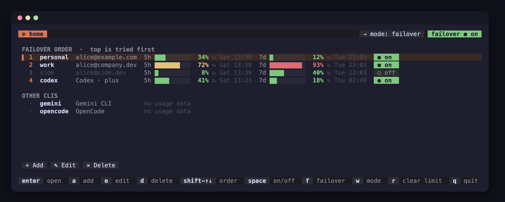
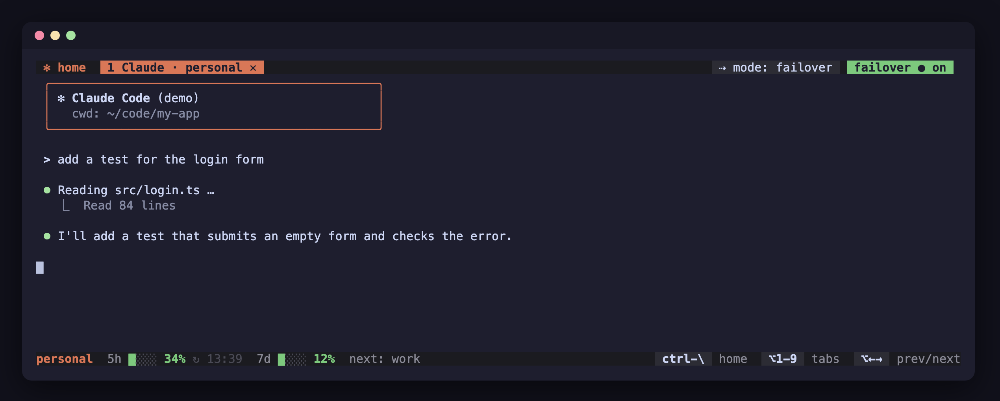
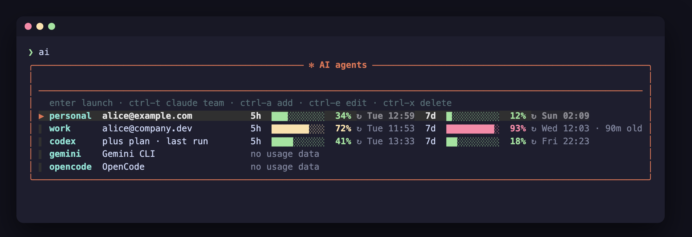

# ai-launcher

One command for all your AI coding agents. Type `ai` to see every agent and account with how much of its plan limit is used, then pick one to start it in the current folder.



- **Every agent in one list.** Claude Code (several accounts), Codex, Gemini, Antigravity, Kimi, OpenCode, Qwen, or any CLI you add.
- **Usage at a glance.** Shows 5-hour and weekly limits with reset times. Bars turn yellow at 60% and red at 90%.
- **Your own launch commands.** Add, edit or delete agents and their commands, from the command line or inside the picker.
- **Trust a folder once** (after `ai trust on`). If any agent trusts the folder, every agent you start through `ai` trusts it too, so they stop asking.
- **No API calls.** Usage comes from files the agents already write on your machine.

There are two front ends with the same config: the TUI shown above (`npm i -g ai-launcher`), and a plain-bash picker that needs nothing installed ([Use it](#use-it)). Both work on macOS, Linux and Windows (PowerShell, CMD or WSL).

## TUI (preview)

A terminal UI with two kinds of tabs:

- **`✻ home`** (the screenshot above) lists every account in failover order: its email, 5-hour and weekly usage bars, when each limit resets, and its `● on` / `○ off` failover switch. Other CLIs are listed below.
- **One tab per running CLI**, using the full window. The bottom line shows that account's usage and, for Claude, which account failover moves to next.



On a narrow terminal, columns and key hints that don't fit are dropped, least important first. When failover triggers, the tab shows a notice: it asks `[y/N]` before moving to the next account (Enter means no), or with auto-switch on (`s`) it counts down 5 seconds and moves by itself (Codex too; the notice says the conversation goes to OpenAI). When a newer version is on npm, a notice appears in the title bar (checked at most once a day in the background; set `AI_LAUNCHER_NO_UPDATE_CHECK=1` to disable).

Install:

```bash
npm i -g ai-launcher            # installs the TUI as the command `ai`
cd tui && cargo build --release # or build it yourself (binary: tui/target/release/ai-launcher)
```

Run `ai [claude args]` (npm install) or `tui/target/release/ai-launcher [claude args]` (built yourself). The first CLI you open gets those args.

The bash tool is also called `ai` (`bin/ai`, when the repo's `bin` is on your `PATH`). Whichever comes first on `PATH` runs. Round-robin, Auto and the decision model are TUI-only; the bash picker has failover and the update notice.

It reads and writes the same config as the bash `ai` (providers file, failover order and flag), so you can use both.

| Key (home) | Does |
| --- | --- |
| `up` `down` / `k` `j` | move selection |
| `enter` | open the selected account in a tab |
| `a` | add an account |
| `e` | edit the selected account |
| `d` | delete the selected account |
| `shift-up` `shift-down` / `K` `J` | change the order (top is tried first) |
| `*` | make the account the default (opens on start, marked `★`); again to clear |
| `space` | turn the account's failover on / off (or click its `● on` / `○ off` switch); an off account is skipped when a limit hits |
| `f` | failover on / off |
| `w` | switch between failover and weighted round-robin |
| `s` | at a limit: auto-switch after a countdown, or ask y/N (default); shown as `switch: auto` / `switch: ask` in the title bar (click it to toggle); turning it off stops a running countdown, which then waits for `y` |
| `+` `-` | round-robin: raise / lower the account's weight (0 to 99, default 1; 0 is never picked) |
| `n` | round-robin: open the next account (or click `› Auto`) |
| `m` | set the Auto decision model |
| `r` | clear the account's limit |
| `x` | close the current tab (highlighted in the tab bar) |
| `1`-`9` | go to tab n |
| `tab` | next tab |
| `q` / `ctrl-c` | quit |

Routing mode (`w`, or click the mode label in the title bar) is saved in `<failover file>.mode`. In failover mode the list is a priority order. In round-robin mode each account shows `×weight`, and `n` (or `› Auto`) opens the next account in a new tab by smooth weighted round-robin: with weights 3 and 1 you get A A B A (then it repeats). Accounts that are off, weight 0 or limited are skipped. Weights are saved in `<failover file>.weights` and the rotation in `$AI_FO_STATE/wrr`, so it continues after a restart.

Optionally let a model choose instead: press `m` and enter a model name (for example `haiku`; empty means plain round-robin). Auto then runs `claude -p --model <model>` on one of your free Claude accounts, with each account's weight and usage, in the background (20 second timeout, the UI keeps working). If it fails, times out or answers with anything but an account name, the round-robin pick is used. The model name is saved in `<failover file>.model`. This is the only thing the tool asks a model; it uses your own `claude` login and counts against its plan. Bash `ai` ignores these files.

In the add form, a Claude account opens its login in a tab. A Codex or Gemini login gets its own login folder when another one of that CLI exists. Other CLI runs any command you type.

Delete asks first, then deletes for good. A Claude account is logged out and its folder (login, history, settings) is removed; if the logout fails, the flash says so (on macOS its Keychain login may remain). A Codex or Gemini account with its own login folder (`~/.ai-accounts/<cli>/<name>`) loses that folder too; the main `~/.codex` / `~/.gemini` (and the folder of a provider named `codex` / `gemini`) is never touched.

| Key (anywhere) | Does |
| --- | --- |
| `alt-1`-`alt-9` | go to tab n, also while typing in a CLI |
| `ctrl-\` | go home, or from home back to the current tab |
| `alt-0` | go home |

On macOS, alt (⌥) keys need "Option as Meta" turned on in the terminal settings (Terminal: Profiles > Keyboard; iTerm2: Profiles > Keys).

| Mouse | Does |
| --- | --- |
| click a tab (or `✻ home`) | go to it |
| click a tab's `✕` | close it |
| click an account | select it; click it again to open it |
| `+ Add` / `✎ Edit` / `× Delete` | add, edit or delete the selected account |
| Failover switch (title bar) | failover on / off |
| Mode label (title bar, `mode: …`) | failover / round-robin |
| `› Auto` (round-robin mode) | open the next account |
| wheel | scroll a CLI's output (unless the CLI uses the mouse itself) |

In a tab, every key goes to the CLI except these:

| Key (in a tab) | Does |
| --- | --- |
| `y` | on a failover notice: move to the next account |
| `enter` | on an auto-switch countdown: move now (does nothing on a `[y/N]` question) |
| `o` | on a failover notice: go home to change the order or pick another account |
| `q` / `esc` | on a failover notice: stop (no move) |
| `enter` | on an ended tab: restart it |
| `x` | on an ended tab: close it |

## Install

Nothing to install first. It's plain bash, which is built into macOS and Linux, and comes with Git for Windows (Claude Code on Windows needs Git anyway). It works from any shell.

**macOS / Linux / WSL**

```bash
git clone https://github.com/Ak1Ena/ai-launcher ~/code/ai-launcher
echo 'export PATH="$HOME/code/ai-launcher/bin:$PATH"' >> ~/.zshrc   # or ~/.bashrc
```

**Windows (PowerShell)**

```powershell
git clone https://github.com/Ak1Ena/ai-launcher $HOME\code\ai-launcher
$p = [Environment]::GetEnvironmentVariable('Path', 'User')
[Environment]::SetEnvironmentVariable('Path', "$p;$HOME\code\ai-launcher\bin", 'User')
```

`ai.cmd`, `cla.cmd` and `cla-team.cmd` run the same script with Git Bash, so `ai` works from PowerShell, CMD or Git Bash. If Git is installed somewhere unusual, set `CLAUDE_CODE_GIT_BASH_PATH` to its `bash.exe`, the same variable Claude Code uses.

Open a new terminal and type `ai`.

**Optional extras.** Each one turns on more features. Without them, everything else still works:

| Tool | Adds | Built into |
| --- | --- | --- |
| [fzf](https://github.com/junegunn/fzf) | Arrow-key picker with search. Without it you get a numbered menu. | — |
| [jq](https://jqlang.org) | Usage bars, shared folder trust and failover | macOS 15+ |
| tmux | Claude team mode (`ctrl-t`, `cla-team`). Not on native Windows. | — |

```bash
brew install fzf tmux            # macOS (jq is built in on macOS 15+, else: brew install jq)
sudo apt install fzf jq tmux     # Linux / WSL
winget install junegunn.fzf jqlang.jq   # Windows (no tmux, so no team mode outside WSL)
```

**Windows notes:**
- Folder-trust sharing between different agents is off on native Windows for now, because each agent's Windows path format still has to be verified. Sharing trust between Claude accounts still works.
- `cla add` copies your settings into a new account instead of linking them, because Git Bash can't make links by default.

### Show Claude usage

Claude Code passes usage to its status line. To save it, point your status line at the bundled script in `~/.claude/settings.json`:

```json
"statusLine": { "type": "command", "command": "bash ~/code/ai-launcher/scripts/statusline-usage.sh" }
```

If you already have a status line command, add it after the script. The script passes the same input on to it:

```json
"statusLine": { "type": "command", "command": "bash ~/code/ai-launcher/scripts/statusline-usage.sh my-statusline --flag" }
```

Usage shows up after your next Claude reply. It is only reported on Pro and Max plans.

## Use it

```bash
ai                 # pick an agent and start it here
ai --resume        # extra arguments go to the agent
```

### Default account

Set a default and `ai` starts it straight away, skipping the picker:

```bash
ai default claude/work   # a Claude account, or any name from `ai ls`
ai default               # show it
ai default -             # clear it
ai pick                  # show the picker anyway
```

In the TUI, press `*` on a row to make it the default (press again to clear); it is marked `★` and opens in a tab when the TUI starts. Both read the same file, `<failover file>.default`. A default that no longer exists is ignored.



When a newer version is on npm, the picker shows an `update X available` line. It reads the same once-a-day cache as the TUI (refreshed in the background with `npm view`, only when npm exists). Set `AI_LAUNCHER_NO_UPDATE_CHECK=1` to turn it off.

| With fzf | Without fzf | What it does |
| --- | --- | --- |
| `enter` | `2` | Start the selected agent |
| `ctrl-t` | `t 2` | Start Claude in team mode (teammates in tmux split panes) |
| `ctrl-a` | `a` | Add an agent |
| `ctrl-e` | `e 2` | Edit the selected agent |
| `ctrl-x` | `x 2` | Delete the selected agent |
| `ctrl-f` | `f` | Turn failover on or off |
| `ctrl-o` | `o` | Open the failover priority screen |

### Manage agents

| Command | What it does |
| --- | --- |
| `ai ls` | List agents with their launch command and label |
| `ai add [name] [command] [label]` | Add an agent. It asks for anything you leave out. |
| `ai edit <name> [command] [label]` | Change the command or label. It asks, showing the current value. Press Enter to keep it. |
| `ai rm <name>` | Delete an agent, after asking you to confirm. A Codex or Gemini agent with its own login folder loses that folder for good; otherwise `ai add <name>` brings it back. |

```bash
ai add aider "aider --model sonnet" "Aider"
ai edit claude "claude --model opus"
```

Agents are saved in `~/.config/ai-launcher/providers`, one per line as `name<TAB>command<TAB>label`. On first run, the file is filled with the agents you have installed. A command runs like a shell alias, so quotes and `VAR=value` prefixes work.

### Several Claude accounts

| Command | What it does |
| --- | --- |
| `cla add work` | Add an account and log in. Settings, skills and plugins are shared with `~/.claude`. |
| `cla` / `cla-team` | Pick a Claude account, then start it normally or in team mode |
| `cla work [team] [args]` | Start a specific account |
| `cla ls`, `cla rm work`, `cla mv work job` | List, remove or rename accounts (`cla rm` asks to confirm, then logs out and deletes the folder for good: login, history and settings; only `AI_YES=1` skips the question; if logout fails it warns and asks again before deleting) |

Accounts live in `~/.claude-accounts/<name>`. Set `CLA_ROOT` to use another folder.

### Several Codex or Gemini accounts

Add another agent that runs the same CLI. The first one uses your normal login; every one after it gets its own:

```bash
ai add personal codex "Codex personal"   # codex is already listed, so this is a separate login
```

Start it from `ai` and log in. Each one gets its own row with its own usage bars (Codex). Logins live in `~/.ai-accounts/<cli>/<name>`, which the CLI gets as `CODEX_HOME` or `GEMINI_CLI_HOME`. Set `AI_ACCOUNTS` to use another folder. A new login starts with fresh settings: nothing is copied from the main one. `ai rm` (and delete in the TUI) deletes that folder for good, never the main `~/.codex` or `~/.gemini`.

Antigravity (`agy`) can't have several accounts yet: it always reads `~/.gemini/antigravity-cli` and has no setting to move it.

### Failover

When a Claude account hits its usage limit, the same session resumes on the next account in your priority order. Codex has no limit hook, so it only gets a written handoff of the session, and the session ends there: accounts below Codex in the order are not tried. New Codex accounts start at the bottom. Failover is off until you turn it on.

You choose what happens when a limit hits with `ai failover auto on|off` (or `s` in the TUI); both read `<failover file>.auto`. Off (the default) asks `[y/N]` and Enter means no: `y` moves to the next account, `o` changes the order, `q` (or anything else) stops. On counts down (`AI_FO_WAIT` seconds, default 5) and then moves by itself: any key (Enter in the TUI) moves now, `o` changes the order, `q` stops. If the next member runs Codex, the card warns that the conversation will go to OpenAI (Codex); it asks or counts down like any other move, so keep Codex out of the order (or off) if it must never get your conversations unattended. Inside a `cla` session, `main` still means `~/.claude`, not the account you are in.

```bash
ai failover on     # or ctrl-f in the picker
ai failover off
ai failover ls     # members in order, with any limit still running
ai failover auto on   # move by itself after a countdown (off: ask y/N, the default)
```

Set the priority with `ai failover` (or `ctrl-o` in the picker). On that screen:

| With fzf | Without fzf | What it does |
| --- | --- | --- |
| `ctrl-u` / `ctrl-d` | `u 2` / `d 2` | Move the member up / down |
| `ctrl-x` | `x 2` | Turn the member on / off |
| `ctrl-r` | `r 2` | Clear its limit |
| `ctrl-f` | `f` | Turn failover on / off |
| `ctrl-a` | `a` | Turn auto-switch on / off (the hint shows `auto-switch: on` / `off`) |

```bash
ai failover order claude/work claude/personal codex   # put these first, in this order
ai failover clear claude/work                         # forget a limit (no name = all)
```

| Variable | Default | What it does |
| --- | --- | --- |
| `AI_FO_COOLDOWN` | `18000` | Seconds an account is skipped after it hits its limit |
| `AI_FO_STATE` | `${XDG_STATE_HOME:-~/.local/state}/ai-launcher/failover` | Where limit marks are kept |
| `AI_FO_WAIT` | `5` | Countdown seconds before an auto-switch (bash) |
| `AI_FO_PROMPT` | "...Continue the work exactly where you left off." | First message sent to the new account |

Needs jq. Not used in team mode. Limits: the cooldown is fixed, not the real reset time (use `ctrl-r` if the limit ended sooner). Codex can't trigger a failover, so put it last. Not available on native Windows (Git Bash yet); use WSL.

## Plugins

Writing a plugin? See [PLUGINS.md](PLUGINS.md).

A plugin adds your own launch entries to `ai`, with no change to this repo. It is a folder with an executable file called `plugin`, in any language (a bash script is fine). Each plugin gets its own section in the TUI home list and its own group in the bash picker. Plugin rows are never part of failover: no priority, no limit marks, no handoff. A limit inside a plugin session moves nothing.

This is different from `plugins/<name>.sh` further down, which only adds usage bars for an agent that is already in the providers file.

Plugins live in `~/.config/ai-launcher/plugins/<name>/` (beside the providers file; set `AI_PLUGINS` to use another folder). `<name>` is letters, digits, `_` or `-`.

```bash
ai plugin add cliproxy                 # a bundled plugin, by name
ai plugin add ~/code/my-plugin         # a local folder (copied in)
ai plugin add owner/repo               # a git repo (GitHub shorthand)
ai plugin add https://example.com/x/y.git [name]   # or any https git URL
ai plugin new <name>                   # start a plugin from the template (see "Writing a plugin")
ai plugin ls                           # installed plugins, on/off, section title, source; then the bundled ones not installed (available)
ai plugin setup <name>                 # review and run an installed plugin's setup again
ai plugin update [name]                # git pull --ff-only for git plugins (all when no name)
ai plugin off <name>                   # stop it without removing it (on: start again)
ai plugin rm <name>                    # asks [y/N], deletes the folder (a symlink loses only the link)
ai plugin do <name> <action>           # run one of the plugin's actions
```

`add` looks at its argument in this order: a bundled name, then an existing local folder, then a git source. Git sources are HTTPS only: an `https://` URL, or `owner/repo`, which becomes `https://github.com/owner/repo.git`. It never overwrites an installed plugin and refuses a folder without an executable `plugin`. New plugins start on, and `add` runs the plugin's `rows` once right away (macOS scans a new script on its first run, which can take seconds). Git needs `git`. The TUI's `p` form follows the same rules and expands a leading `~/`.

**Setup scripts.** A plugin may ship an optional `setup` file for the work that must happen once (install a tool, make keys, log in). `add` first copies the plugin into a hidden staging folder `.<name>.install` (never listed, never run), then shows you the whole `setup` with line numbers, control bytes as `^X`. Only after you approve (`y`) does it run, once, with your terminal, in the plugin folder, with `AI_PLUGIN_DIR` set. What you read is a copy, and the copy is what runs. If you say no, or setup exits non-zero, or you press Ctrl-C, the staging folder is deleted and nothing is installed (`setup failed (exit N): plugin not installed`). `ai plugin setup <name>` does the same for an installed plugin; a failure there keeps the plugin, and `config` is saved as `config.bak` first. `setup` must be a regular file, never a link. `update` never runs setup: it only says `setup changed: run setup again to apply`. In tests only, `AI_YES=1` approves the review without asking (and `rm` without asking).

`ai plugin new <name>` copies `templates/plugin/` into the plugins folder and does not run its setup. `ai plugin ls` ends with an `available` list: bundled plugins not installed yet, with `(has setup)` when they need one.

TUI keys on a plugin row: `a` actions (the plugin's tabbed menu when it has one, see "Menu"), `o` on/off, `u` update, `d` delete, `e` show its folder. `p` (or the `+ Plugin` button) opens the Plugins screen with its add form, from anywhere on home. On a plugin row, `a`, `d` and `e` are plugin actions; adding an account stays on the button and on other rows.

`P` (or the `Plugins` button) opens the Plugins screen: installed plugins (name, `about` or title, status `● ok` / `× failed` / `·` off / `loading…`, on/off, `actions`, `↻ update` for git plugins, `[-]`), then bundled plugins not installed yet (`has setup`, `[+]`), then `[+ Add from git / folder]`. In it: Enter actions, space or `o` on/off, `u` update, `-` remove (asks first), `+` installs the bundled plugin under the cursor or opens the add form, `/` searches names and `about` text. Esc closes the innermost thing: the add form, the search text, then the screen. Every `[+]`, `[-]`, `actions`, `↻ update` and on/off is clickable. `s` runs the setup of the plugin under the cursor again.

**Review in the TUI.** Installing a plugin that has a `setup` (`+` / `[+]` / the add form) opens the review over the Plugins screen: the whole script, numbered, long lines wrapped, invisible characters shown as `<U+XXXX>`. Enter (or `[ Approve and install ]`) approves, Esc cancels, arrows and PgUp / PgDn scroll. Approve is ignored for 0.7 s after the review opens, so a stray key cannot approve it, and a window too small to show the buttons refuses approval. Approved, the script runs in its own tab. Closing that tab counts as a failure (`setup failed (tab closed): plugin not installed`). If you are not in the Plugins screen when a staged install is ready, a message says `<name> ready to review: open Plugins`. `-` refuses while a plugin is busy (installing, in review or running setup). The review opens only inside the Plugins screen.

### Writing a plugin

For developers and AI agents. Quick start:

```bash
ai plugin new demo          # copies templates/plugin/ to ~/.config/ai-launcher/plugins/demo/
$EDITOR ~/.config/ai-launcher/plugins/demo/plugin
ai                          # the demo section shows up in the picker
```

`ai` runs `plugin <command>` in your current folder, with no tty and the env var `AI_PLUGIN_DIR` set to the plugin's folder (keep config and cache there). On Windows it runs `bash <dir>/plugin`.

| Command | Output | Limit |
| --- | --- | --- |
| `rows` | First line `section<TAB><title>`. Then one line per entry: `<id><TAB><label><TAB><status text>`. A line `  <TAB><text>` (two spaces, a tab) is a detail line shown under the entry above it. | 2 s (in the TUI, a plugin's first call in a session gets 10 s). A failure or timeout shows `<name>: plugin failed`. |
| `actions` (optional) | One line per action: `<action><TAB><label>`. | 2 s (TUI first call: 10 s) |
| `menu` (optional, TUI only) | Tabs for the TUI's `a` window, see "Menu" below. Without it, `a` shows the `actions` form. | 2 s (TUI first call: 10 s) |
| `do <action>` | Runs the action. stdin is closed; stdout and stderr are shown. `rows` refreshes afterwards. | 30 s, then it is killed |
| `launch <id> [args...]` | Runs the session in the foreground with the terminal (bash: `exec`, TUI: its own tab). | none |

An entry `<id>` is letters, digits, `.`, `_` or `-`. Status and detail text is plain text; the bash picker shows ANSI colour, the TUI strips it. Other files refer to an entry as `plugin:<name>/<id>` (for example the default entry); an id that no longer exists is ignored. In the bash `ai`, launches share folder trust like any other (only with `ai trust on`); the TUI has no shared trust.

Two marker files sit in the plugin folder. `.off` (empty) turns it off: it is never run, and its section shows `<name> · off`. `.source` holds the git URL it was installed from, used by `update`. A plugin is code you chose to run, with your permissions, so install only plugins you trust. `ai plugin add|update` with a git source is the only time `ai` touches the network for plugins; everything else is up to the plugin.

**Menu.** With `menu`, `a` on a plugin row (or Enter in the Plugins screen) opens one window with a tab per `tab` line. Tab-separated lines; anything else is skipped, and a tab left empty is dropped:

```
tab<TAB>list|radio|checklist<TAB><title>[<TAB>order|weight]
item<TAB><id><TAB><label>[<TAB>on]
row<TAB><key><TAB><label><TAB>1|0<TAB><n|-><TAB><note><TAB><on-id><TAB><off-id><TAB><dec-id><TAB><inc-id>
```

- `list`: its `item`s; Enter runs `do <id>`. `radio`: the same, and `on` marks the current choice (`●`, others `○`).
- `checklist`: its `row`s, `order` (default) or `weight`. `1` = ticked (in use). `<n>` is the position (`order`) or the weight 0..99 (`weight`); `-` means not placed (for example not linked yet): it shows no number and never moves. `dec` / `inc` are move up / down (`order`) or weight -1 / +1 (`weight`). An id of `-` means that change is not offered.
- Keys: ←/→ (or Tab) switch tabs, ↑/↓ move, space ticks, `shift-↑/↓` (or `K`/`J`) reorders an `order` list, `+`/`-` changes a weight. Nothing runs until Enter; Esc closes with no change.
- Enter on a checklist runs `do` once per step, in this order: ticks of rows not placed (on-id, e.g. a link), then other ticks (on-id / off-id), then moves (a row's dec-id once per place it rises, which reaches any new order), then weights (inc-id or dec-id once per step). A failure doesn't stop the rest. Then the plugin reloads, and one line says `applied N changes` or `K of N changes failed: <id> failed: <why>; …`.
- Every id and key is an action id (`[A-Za-z0-9._-]+`). The window runs the ids of the menu it opened with, never a list refreshed meanwhile. Bash `ai` has no menu window and ignores `menu`; `ai plugin do <name> <id>` runs the same ids.

**`setup` contract** (optional file, same folder as `plugin`):

- A regular file, not a link. It runs once, with a tty, only after the user reads and approves it.
- `AI_PLUGIN_DIR` is set and it runs in that folder. Keep state in files relative to it.
- Exit 0 means installed. Anything else means failed: a new install is removed, an existing plugin is kept.
- It must be safe to run again (`ai plugin setup <name>`): check before you change anything, and never overwrite user config.
- It is shown in full before it runs, so keep it readable, without hidden or control characters.

**`about` contract** (optional file): the first line is a short description (60 characters, control characters dropped). It is shown in the Plugins screen, in `ai plugin ls` and in the available list.

**Rules for `plugin`:**

- `rows` and `actions` are fast and never prompt (no tty, 2 s limit). Cache anything slow.
- Plain text only. Never print secrets (keys, tokens, URLs with credentials).
- No network in `rows` unless the plugin's purpose needs it, and then cache the answer.
- Keep config and cache under `AI_PLUGIN_DIR`, with mode 600 for anything secret.

**Test by hand:** `AI_PLUGIN_DIR=$PWD ./plugin rows` (also `actions`, `do <action>`). For setup, run `AI_PLUGIN_DIR=$PWD bash setup` twice. For a fuller check, build a fake environment like `tests/cliproxy.sh` does: a temporary `$HOME`, a fake proxy or fake commands first on `PATH`, never real config.

**Publish:** put `plugin` (and optionally `setup`, `about`) at the top of a git repo; others install it with `ai plugin add owner/repo`.

### cliproxy

The bundled `cliproxy` plugin starts Claude Code through [CLIProxyAPI](https://github.com/router-for-me/CLIProxyAPI), a local proxy that holds several logins (Claude, Codex, Gemini...) and spreads requests across them. You get one row, "Claude Code · all accounts", that works like one more account for all of them together. The failover section stays as it is. It starts `claude` with `--settings <plugin>/cache/claude-settings.json` (mode 600), which holds the proxy URL and client key, because an `env` block in `~/.claude/settings.json` (another `ANTHROPIC_BASE_URL`, such as a local compression proxy) would otherwise win over the environment and send the key to the wrong server ("401 Invalid bearer token", then a login prompt). The proxy picks the account by model: Claude models go to Claude accounts, and GPT models (`gpt-…`, listed in Claude Code's `/model` because the plugin turns on gateway model discovery) go to Codex accounts. Codex accounts do not take over Claude-model requests by themselves; pick a GPT model with `/model` to use them.

`ai plugin add cliproxy` runs its setup after you review it (again later with `ai plugin setup cliproxy`, the way to add accounts):

1. **Install.** Uses `cliproxyapi` on `PATH`, brew's, the plugin's own `bin/` copy, or a proxy already answering at `url`. Otherwise it offers `brew install cliproxyapi`, or without brew downloads the latest release for your OS into `plugins/cliproxy/bin/` after checking it against the release's `checksums.txt` (and fills `start_cmd` / `stop_cmd`). Choosing "myself" prints the command and stops. Setup never installs Homebrew.
2. **Keys.** Makes a client key and a management key once and keeps them in `config` (mode 600). It edits the proxy's `config.yaml` (brew: `$(brew --prefix)/etc/cliproxyapi.conf`, else `plugins/cliproxy/run/config.yaml`) only to fill an empty `secret-key` and to add a client key when there is none; before the first edit of a run it backs the file up to `config.yaml.ai-launcher.bak` (`.ai-launcher.bak.<epoch>` when that exists, so an older backup is never replaced), and each edit replaces the file atomically with its permissions kept. The same edit rewrites an `auth-dir: "~/…"` value to the absolute `$HOME/…` (a launchd or other service has no `~`, and Codex uploads fail with "mkdir /~: read-only file system"). A proxy that already has a management key uses `CLIPROXY_MGMT_KEY` or the copy setup kept in `<proxy config>.ai-launcher.key` (see Remove) when the proxy accepts it; otherwise it asks you to paste it, or, when setup can write its config, to **reset** it: the proxy stores that key only as a hash, so after `ai plugin rm cliproxy` and `add` nobody has it any more. Reset backs the config up first (to `.ai-launcher.bak`, or `.ai-launcher.bak.<epoch>` when that exists), writes a new random `secret-key` (the running proxy reloads and hashes it), waits up to 10 s until the proxy accepts it, and saves it. With no `key=` saved, setup offers a client key already in the config's `api-keys` once the proxy accepts it, instead of making a new one. Existing client keys stay, and the new one is appended through the management API. A proxy that is already running with a config setup does not know asks for that config's path or for its two keys. Every key you give is checked against the proxy before it is saved (3 tries), and setup says ready only when the client key works. A proxy config that setup itself just created or installed (the stock brew config, or `run/config.yaml`) loses its sample `your-api-key-*` keys and listens on 127.0.0.1 only; a config that was already there is never touched except for the key edits above, and is backed up first. If setup fails after starting the proxy, it stops it again.
3. **Accounts.** A checklist of your `cla` accounts and Codex providers. For each ticked one you choose **link existing login (no browser)**, the default, or **sign in again (browser)** (`-claude-login`, `-codex-device-login`). Link copies the login the account already has into the proxy (see "Link" below); when it finds none, setup signs in instead. Accounts the proxy already has are kept.
4. **Start.** Starts the proxy if it is down, then sets failover mode and session affinity.

It needs `curl`, and `jq` for accounts and the usage lines. To set it up by hand instead, export `CLIPROXY_API_KEY` (a client key from the proxy's config) and `CLIPROXY_MGMT_KEY` (its management key).

The first `rows` call creates `plugins/cliproxy/config` (mode 600). It is read as `key=value` lines, never run as a script:

| Key | Default | What it does |
| --- | --- | --- |
| `url` | `http://127.0.0.1:8317` | Where the proxy listens |
| `key_env` / `key` | `CLIPROXY_API_KEY` | Env var holding the client key, or the key itself (`key` wins) |
| `mgmt_key_env` / `mgmt_key` | `CLIPROXY_MGMT_KEY` | Same, for the management key |
| `start_cmd` / `stop_cmd` | none | Commands for the start / stop actions when brew has no `cliproxyapi` (run with `bash -c` in the plugin folder) |
| `proxy_config` | set by setup | The proxy's `config.yaml` that setup edits (a relative path is inside the plugin folder) |
| `mode` | `failover` | `failover` or `wrr` (weighted round-robin): how the "all accounts" row uses accounts (see below). An old `balance` reads as `wrr`. With no `mode=` line, a proxy already on `round-robin` or `weighted-round-robin` is read as `wrr` |
| `order` | none | Failover order: auth file names, comma-separated. Set by the move actions |

Each line is `key=value`. A ` #` (space then `#`) or tab then `#` starts a comment, and a line starting with `#` is skipped. Quotes are not removed: `key="abc"` gives the key `"abc"` with the quotes.

The row says `proxy up`, `proxy not running` with the start hint, or `no key`. With a management key it adds lines per provider: merged 5h and weekly bars (the average used % across that provider's accounts, with the soonest reset) for Claude and Codex, the number of accounts, request and failed counts, and the model names the proxy serves. It does not show tokens per model. The numbers are cached for 60 seconds and refresh in the background, so the row stays quick. Without a management key it shows a hint instead.

Actions `start` and `stop` run `brew services` or your `start_cmd` / `stop_cmd` (`a` in the TUI, `ai plugin do cliproxy start`). Choosing the row runs `claude` with `ANTHROPIC_BASE_URL`, `ANTHROPIC_AUTH_TOKEN` and gateway model discovery set for that session only, using your main `~/.claude`; nothing in `settings.json` changes and the key is never printed (both keys are also removed from claude's environment). If the proxy is down it prints the hint and does not start it. Pick GPT, Gemini or Claude models inside Claude Code with `/model`.

**Keep the prompt cache.** Every account and every provider has its own prompt cache. If the proxy's load balancer moves a chat to another account, the whole context is read again at full price. Turn on CLIProxyAPI's session affinity so each chat stays on one account: the section shows `⚠ session affinity off` when it is off, and the action **Keep each chat on one account** (`a` in the TUI, `ai plugin do cliproxy affinity`) sets `routing.session-affinity` and `session-affinity-subagents` to true (TTL `1h` if none is set) through the management API. It changes the proxy only when you choose it. Switching `/model` to another provider in the middle of a chat always re-sends the whole context, because caches are not shared between providers, so pick the model at the start of a chat.

**Failover or weighted round-robin.** The section title shows the mode: `CLIPROXY · all accounts · failover` or `· weighted round-robin`. These modes belong to the cliproxy section only; the home tab's own failover is separate.
- **failover** (default): one account until it is limited, then the next, in your order. The chat keeps going in the same Claude Code session with its whole history, with no restart. The first request on the new account reads the context once more without the cache. The plugin sets the proxy's `routing.strategy` to `fill-first` and `routing.cooldown.disable-cooling` to false (with cooling off, the proxy would keep picking a limited account), and gives each account a priority from the order: the first gets the account count × 10, each next one 10 less (the proxy picks the highest priority first).
- **wrr**: chats are spread across accounts by weight, and session affinity keeps each chat on one account. The plugin sets `weighted-round-robin`, turns session affinity on, and sets every account's priority to 0, because the proxy weights only the accounts in the top priority tier.

Switch with the actions **Mode: failover** / **Mode: weighted round-robin** (`a` in the TUI, or `ai plugin do cliproxy mode-failover` / `mode-wrr`; `mode-balance` still works as the old name of `mode-wrr`). They write `mode=` into the config, then change the proxy with one `PATCH /v8/management/config`; an older proxy without v8 gets only the strategy, through `PUT /v0/management/routing/strategy`. Both modes then send the account priorities. Without a management key only the config changes, and the plugin says `proxy not changed (no management key)`. When the proxy does not match the mode, the section shows `⚠ proxy uses <strategy>, plugin mode is <mode>` and an **Apply** action (`ai plugin do cliproxy apply`). The proxy changes only on these actions, the account actions below, and **Keep each chat on one account**. Session affinity and the mode check need a management key and a proxy with the v8 management API.

**Accounts.** With a management key the section lists each Claude and Codex account in the proxy, in failover order: `1  <email>  on` (or `off`) in failover, `<email>  ×N` (or `off`, for an unused account or weight 0) in wrr. Actions per account (`<idx>` is the account's auth index):
- both modes: **`<email>: don't use`** (`off.<idx>`) / **`<email>: use`** (`on.<idx>`). They set the account's `disabled` through `PATCH /v8/management/credentials/status` (v0: `/v0/management/auth-files/status`). An unused account keeps its place in the order and its weight.
- failover: **`<email>: move up (N → N-1)`** (`up.<idx>`, not on the first) / **`move down (N → N+1)`** (`down.<idx>`, not on the last). They rewrite `order=` and send the new priorities. Accounts missing from `order=` follow in file-name order; names that no longer exist are dropped.
- wrr: **`<email>: weight N → N+1`** (`wup.<idx>`) / **`weight N → N-1`** (`wdown.<idx>`, only above 0), for accounts in use. Weights go from 0 to 99, default 1; 0 means the account is never picked. Weights only pick the account for a new chat: session affinity still keeps each chat on its account.

Weights and priorities go through `PATCH /v8/management/credentials/fields` (v0: `/v0/management/auth-files/fields`), never by editing auth files, and take effect at once. Every account action reads the account list live first, and needs the management key (`needs the management key` otherwise). The section reads only the 60-second cache, so it stays quick.

**Link.** With a management key, every `cla` account and Codex provider whose email (any case) the proxy does not have yet is listed as `<email>  not linked`, so one added with the launcher's "+ Add" shows up at once. The action **`<email>: link to proxy`** (`link.<kind>-<name>`) or **Link all launcher accounts** (`ai plugin do cliproxy link`) uploads that account's own login as a proxy auth file (`POST /v0/management/auth-files`, `claude-<email>.json` / `codex-<email>.json`), with no browser. A Claude login comes from the macOS Keychain (item `Claude Code-credentials-<first 8 hex of sha256 of the account folder path>`, read with `security`) or from `<account>/.credentials.json`; a Codex login from its `auth.json`. Tokens are never printed, never on a command line, and only briefly in a mode-600 temp file in the plugin's cache. Actions have no terminal, so a Keychain prompt may block them; the entry **+ Link launcher accounts** does the same in a terminal. Each account reports `linked <email>` or `skipped <email>: <reason>`.
The trade-off: a linked account shares one login between `cla` (or Codex) and the proxy. Refresh tokens rotate (each refresh replaces the old one), so a token refresh on one side will likely sign the other side out. If that happens, log the `cla` account in again (`cla <name>`), or give the proxy its own login with setup's "sign in again". The proxy keeps the copied tokens in plaintext in its own auth directory, like every login it holds. Link never uploads over a proxy file of the same name, and links each email once.

**TUI menu.** In the TUI, `a` on the cliproxy row opens its tabs (`plugin menu`): **Actions** (start, stop, apply, keep each chat on one account, link all), **Mode** (failover / weighted round-robin, current one `●`), and **Accounts**, a checklist of the proxy's Claude and Codex accounts, then the launcher accounts not linked yet. Tick = use (a not-linked one: link it), untick = don't use; in failover `shift-↑/↓` sets the order, in weighted round-robin `+`/`-` the weight. Enter runs the same `link.` / `on.` / `off.` / `up.` / `wup.` / `wdown.` actions as `ai plugin do`. Linking pins the current order into `order=` first, so new accounts land after it.

**Remove.** `ai plugin rm cliproxy` deletes the plugin folder, and with it the saved client and management keys in `config`. The proxy and its config stay, and so does `<proxy config>.ai-launcher.key` (mode 600), a copy of the management key that setup keeps beside a proxy config outside the plugin folder: the proxy stores that key only as a hash, so a new `add` reuses this copy (once the proxy accepts it) instead of asking you to paste or reset it. Delete that file to forget the key. Setup prints the management key at the end of each run (`management key: …`), with where it is saved, so you have it for the proxy's web panel or another tool; it never prints the client key.

**When every account is limited.** The section shows `⚠ all Claude accounts limited · next reset ↻…` (the same for Codex). CLIProxyAPI has no built-in fallback to another model: when every Claude account is limited, Claude Code gets HTTP 429 `model_cooldown` from the proxy. Pick another model yourself with `/model`, or wait for the reset.

## How it works

**Usage.** Nothing is fetched from the internet:
- **Claude:** reads `<account>/usage/usage.json`, written by `scripts/statusline-usage.sh`. The numbers are from that account's last session. Rows older than 10 minutes show their age, and a limit whose reset time has passed shows 0%.
- **Codex:** reads the rate limits saved in the newest `sessions` log of `~/.codex`, or of that agent's own login folder.
- **Other agents** don't save usage, so they show "no usage data".

**Folder trust.** When you start an agent through `ai` or `cla`, it checks whether the folder is trusted by any of Claude (main config and every account), Codex, Gemini, Qwen or Antigravity. If one trusts it, the folder is marked trusted in the others too.
- Sharing is off by default. Turn it on with `ai trust on` (`ai trust off` to stop, `ai trust status` to check). A trusted folder lets each agent load that folder's hooks, settings and MCP servers, so only turn it on if you trust every folder you open.
- Only that exact folder is shared. Parent folders don't count.
- A folder you marked untrusted in an agent stays untrusted there.
- Even with sharing off, `cla` still copies the main account's accepted folder trust into the cla accounts (Claude to Claude only, nothing to other agents).

**Staying awake.** On macOS, agents run under `caffeinate -i` so the machine doesn't sleep mid-task.

## Security

- `cla add` links `settings.json`, `hooks`, `plugins` and `projects` from `~/.claude` into the new account. So an `env` entry there (for example `ANTHROPIC_API_KEY`) or an `apiKeyHelper` applies to every account, and chat transcripts are shared through `projects`.
- Delete is permanent, with no trash. `cla rm` (and delete in the TUI) logs the account out, then removes its folder with its login (`.credentials.json` on Linux), history and settings. It never follows links: the shared `~/.claude` files the account links to stay, and a symlinked account folder loses only the link. Deleting a Codex or Gemini agent removes only its own `~/.ai-accounts/<cli>/<name>` folder.
- Auto-switch (`ai failover auto on`) moves a session to the next account without asking, Codex included, which sends the conversation to OpenAI. Turn Codex off in the order if that must not happen unattended.
- `cla mv` never copies secrets. On macOS you log in again after a rename, because Claude ties the Keychain login to the folder path.

## Add usage bars for another agent

An agent with no plugin gets a plain row. To show usage, create `plugins/<name>.sh`, where `<name>` is the agent's name in `ai ls`:

```bash
_ai_mytool_rows() {                      # print one picker row per account
  _ai_row mytool <id> <shown-name> "<label>" "$(_ai_bar 5h <percent> '<reset time>')"
}
_ai_mytool_run() { shift; _ai_exec "$(_ai_cmd mytool mytool)" "$@"; }   # optional; $1 = row id
```

To share folder trust with another agent, add its name to `AI_TRUST` and define `_ai_trust_<name>_has` and `_ai_trust_<name>_add` in `lib/trust.sh`.

## Test

```bash
bash tests/check.sh
/bin/bash tests/check.sh     # on macOS: also check with the built-in bash 3.2
```

This runs every feature against a throwaway home folder and never touches your real configs.

## Releases

CI runs on branches and PRs. Every merge to main builds all platforms and creates or updates a draft release `v<version>`, where the version is in `tui/Cargo.toml`. Publishing the draft triggers the npm publish (needs the `NPM_TOKEN` secret). Bump the version in `tui/Cargo.toml` before the next release.

## License

MIT
